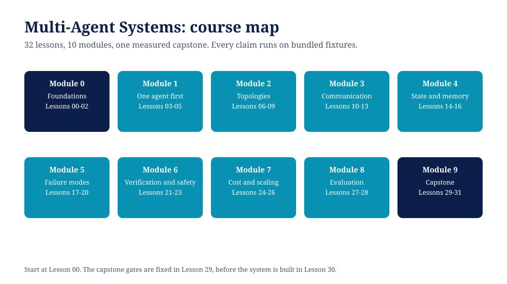

# Multi-Agent Systems

**A free, builder-level course on designing systems of cooperating AI agents, where every claim about coordination is measured by code you can run: topologies, message schemas, handoffs, failure modes, coordination cost accounting, and a capstone multi-agent system graded against gates fixed before it was built.**



Most multi-agent material teaches a framework's API. This course teaches the coordination itself, framework-free and offline: when a team of agents beats one agent, when it provably does not, what each topology costs in messages and tokens, how errors cascade and amplify between agents, and how to put a check where it removes the most failures. The agents are small deterministic stand-ins (rule-based workers over a bundled lead-processing fixture set), so every number in every lesson reproduces exactly on any machine with Python 3.10 or newer. No API keys, no framework installs, no live models.

## What you will be able to do

- Price coordination before you buy it: messages, tokens, and steps per task, and cost per success, from a ledger you build in Lesson 02
- Choose a topology per workload family (sequential, parallel, hierarchical, debate, blackboard, routed) using a decision table computed from measurements, not preference
- Design handoffs that keep typed state intact, and recognise the exact band changes that prose summaries cause
- Name and reproduce the failure modes unique to multi-agent systems: cascading extraction faults, clarification loops, allocation deadlock, error amplification, conflicting winners
- Put verification where it pays: a reviewer, selective routing, permission boundaries, and termination budgets, each with its measured effect
- Evaluate a multi-agent system per agent, attribute injected faults to the stage that caused them, and profile your failures against the published MAST taxonomy
- Build a capstone lead-processing system (router, workers, reviewer, field check) and read its honest verdict against gates fixed in writing before the build

## Feasibility note (read this first)

This course models stable vendor and production behaviour and complements it with the controlled research literature, so the design judgement transfers to real LLM agents even though the runnable artifacts use deterministic stand-ins. The stand-ins are labelled as such everywhere they appear; nothing here calls a live model, which is precisely what makes the measurements reproducible. Where framework or production numbers are quoted (Anthropic's multi-agent research system, Google's scaling study, the MAST failure taxonomy), the source and date are given in [RESEARCH.md](RESEARCH.md), checked 2026-11-06.

## Capstone scorecard

The capstone (Lessons 29 to 31) is a Fernhill lead-processing system: a router sends trap orders (discount asks, missing budgets) to a reviewer and clean orders past it; a sequential pipeline extracts, scores, and drafts; a hardening field check re-reads thin extractions with the careful extractor. Its gates were fixed in `29-capstone-spec/capstone/gates.json` before the capstone code was written, set from the single-agent baseline of Lesson 03.

Measured on the 12-order fixture set:

| Gate | Fixed threshold | As built | Hardened |
|---|---|---|---|
| Task success rate | at least 0.9 | 0.8333 (fail) | 1.0 |
| Policy escapes | at most 0 | 0 | 0 |
| Mean messages per order | at most 8 | 5.33 | 6.0 |
| Tokens per success | at most 400 | 362.9 | 349.3 |
| Success delta vs single agent | at least 0.15 | 0.25 | 0.4167 |

The as-built system failed its success gate and the course prints that verdict in full (Lesson 31): routing and review fixed every draft-level failure and none of the extraction failures, because no component re-read the source. The hardening (a field check at the extractor boundary) passes all five gates. Two honest residues remain on the record. The hardened system still costs about 2.06x the tokens per success of the single agent (349.3 against 169.7), and on independent orders the single agent remains the cheapest way to succeed. Coordination bought correctness on the hard families, at a price, and the price is printed next to the result.

## Course map

| Module | Lessons | What it covers |
|---|---|---|
| 0. Foundations | 00-02 | Setup, what makes a system multi-agent, the coordination ledger |
| 1. One agent first | 03-05 | The single-agent baseline, decomposition, the lesson where multi-agent loses |
| 2. Topologies | 06-09 | Sequential pipeline, parallel fan-out, hierarchical teams, routing |
| 3. Communication | 10-13 | Message schemas, handoffs and state, the blackboard, debate and voting |
| 4. State and memory | 14-16 | Shared memory, private vs shared context, history and loss across hops |
| 5. Failure modes | 17-20 | Cascading errors, loops, deadlock and timeouts, conflicting outputs |
| 6. Verification and safety | 21-23 | The reviewer, permission boundaries, termination and budgets |
| 7. Cost and scaling | 24-26 | Cost accounting, scaling the team, choosing a topology |
| 8. Evaluation | 27-28 | Per-agent metrics and fault attribution, the failure taxonomy in practice |
| 9. Capstone | 29-31 | Spec and gates, build, evaluate and harden |

Track yourself in [PROGRESS.md](PROGRESS.md). The design decisions and their evidence are in [DESIGN.md](DESIGN.md) and [RESEARCH.md](RESEARCH.md).

## How each lesson works

Every lesson folder contains:

- `README.md`: the concept, the code walkthrough, and the measured results
- one runnable Python artifact (standard library only)
- `exercise.md`: a task whose answer requires running a variant of the code
- `solution/SOLUTION.md`: the worked solution, with the measured numbers
- `smoke_test.py`: run it to verify the artifact on your machine

## Quick start

```bash
git clone https://github.com/techaurah/multi-agent-systems-course.git
cd multi-agent-systems-course
python3 03-the-single-agent-baseline/single_agent.py
python3 31-evaluate-and-harden/evaluate_capstone.py
python3 tools/validate_course.py
```

## Honesty rules of this course

- Every number quoted in a lesson is produced by that lesson's code on the bundled fixtures. If you cannot reproduce a number, that is a bug; please open an issue.
- The course includes its negative results in the same typeface as its wins: multi-agent ties or loses on chained work (Lesson 05), hierarchy pays a delegation tax (Lesson 08), blackboard tokens price pointers rather than content (Lesson 12), and the capstone failed a gate before it passed (Lesson 31).
- External figures are cited with source and date in RESEARCH.md. Nothing is rounded into a claim the source did not make.
- The agents are deterministic stand-ins, labelled as such. The coordination behaviour they exhibit (cost, cascades, loops, deadlock, amplification) is the subject of the course; fluent model behaviour is not simulated and not claimed.

## FAQ

**Is it really free?** Yes. MIT licensed, no paid tier, no gated lessons.

**Do I get a certificate?** No. You get a portfolio artifact instead: a measured multi-agent system, a cost ledger, and a gate verdict you can show and defend line by line.

**Do I need API keys or a framework?** No. Python 3.10+ standard library only. The course is deliberately framework-free so the coordination concepts survive any framework's next release.

**How is this different from your other courses?** [Context Engineering](https://github.com/techaurah/context-engineering-course) is about one agent's window: what enters it and at what price. [Agentic AI for Beginners](https://github.com/techaurah/agentic-ai-for-beginners) is the general builder course and touches multi-agent in a single lesson. This course goes deep on agent-to-agent interaction itself: topologies, protocols, shared state, and the failure modes that only exist between agents.

**How long does it take?** 32 lessons at roughly 30 to 60 minutes each. The capstone lessons run longer by design.

**Can I use the code in my own projects?** Yes, MIT. The `mas` package and the fixtures are yours to adapt.

## About TechAurah

TechAurah is the academy name of TechAura, an AI and software engineering company that builds intelligent systems for businesses and publishes what it learns as free, runnable courses. More courses and projects: [github.com/techaurah](https://github.com/techaurah). Company background: [TechAura on LinkedIn](https://www.linkedin.com/company/techaurah/).

## License

MIT. See [LICENSE](LICENSE).
